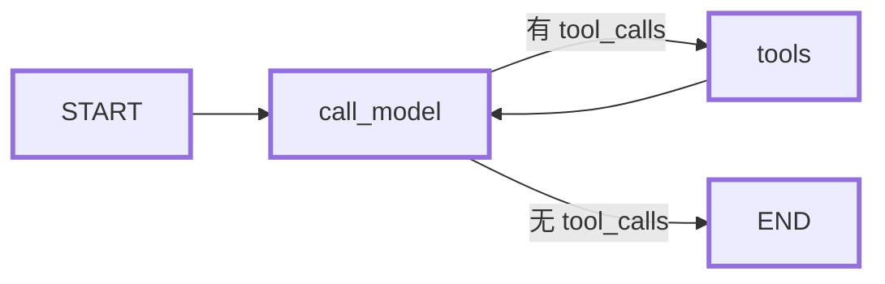

# ReAct Agent（LangGraph + DeepSeek）

基于 [LangGraph](https://github.com/langchain-ai/langgraph) 的 ReAct 智能体，由官方 react-agent 模板改造而来。默认使用 DeepSeek 作为对话模型，并通过 DeepSeek Search API 提供网页搜索能力。


## 工作原理

智能体按照 ReAct（Reasoning and Action）循环运行：

1. 接收用户问题
2. 模型推理并决定是否调用工具
3. 执行所选工具（当前为网页搜索）
4. 观察工具返回结果
5. 重复 2–4 步，直到给出最终回答



核心逻辑位于 [src/react_agent/graph.py](./src/react_agent/graph.py)：`call_model` 负责调用模型并绑定工具，`route_model_output` 根据最后一条消息是否包含工具调用来决定继续执行工具还是结束。达到递归上限的最后一步若仍在请求工具，会返回超步提示而不是继续循环。

## 环境要求

- Python >= 3.11（CI 覆盖 3.11 / 3.12）
- [uv](https://docs.astral.sh/uv/)
- 一个 DeepSeek API Key（对话与搜索共用）

## 快速开始

1. 安装依赖

```bash
uv sync --locked
```

2. 配置环境变量

```bash
cp .env.example .env
```

在 `.env` 中填入：

```dotenv
MODEL=deepseek/deepseek-flash
DEEPSEEK_API_KEY=your-deepseek-api-key
MAX_SEARCH_RESULTS=10
LANGSMITH_PROJECT=react-agent
```

`MODEL` 会自动从 `.env` 读取（见 [context.py](./src/react_agent/context.py)）；如果改用其他厂商的模型，需要额外配置对应的 API Key，例如 `ANTHROPIC_API_KEY`、`OPENAI_API_KEY`、`FIREWORKS_API_KEY`。网页搜索始终使用 `DEEPSEEK_API_KEY`。

3. 启动 LangGraph 开发服务器

```bash
uv run langgraph dev
```

浏览器会自动打开 LangGraph Studio，可在其中对话、回放和调试每一步执行过程，也可以从历史状态重跑指定节点。图定义在 [langgraph.json](./langgraph.json)，图名为 `agent`。

## 配置项

运行时配置定义在 [src/react_agent/context.py](./src/react_agent/context.py)：

| 配置 | 环境变量 | 默认值 | 说明 |
| --- | --- | --- | --- |
| `model` | `MODEL` | `deepseek/deepseek-flash` | 对话模型，格式为 `provider/model` |
| `max_search_results` | `MAX_SEARCH_RESULTS` | `10` | 每次搜索返回的结果数，范围 1–50 |
| `system_prompt` | `SYSTEM_PROMPT` | 内置提示词 | 系统提示词，运行时自动注入当前时间 |

通过参数传入的值优先于环境变量。提示词默认定义在 [prompts.py](./src/react_agent/prompts.py)。

## 内置工具

[search](./src/react_agent/tools.py) 调用 `https://api.deepseek.com/v1/tools/search`，返回网页链接、摘要和可用的正文内容。它会校验：

- 查询词长度 1–128 个字符
- `max_search_results` 在 1–50 之间
- 必须配置 `DEEPSEEK_API_KEY`

HTTP 错误、超时等异常会直接向上抛出，由 LangGraph 记录为工具错误。

## 项目结构

```
.
├── langgraph.json              # LangGraph 应用入口与图声明
├── Makefile                    # 测试与代码检查命令
├── src/react_agent/
│   ├── graph.py                # ReAct 图：节点、路由与循环
│   ├── tools.py                # DeepSeek Search 工具
│   ├── context.py              # 运行时配置（模型、提示词、搜索数量）
│   ├── state.py                # 输入状态与完整状态定义
│   ├── prompts.py              # 默认系统提示词
│   └── utils.py                # 模型加载等辅助函数
└── tests/
    ├── unit_tests/             # 离线单元测试（Mock HTTP）
    └── integration_tests/      # 真实模型调用集成测试
```

## 开发

### 常用命令

```bash
make test                 # 运行单元测试
make integration_tests    # 运行集成测试（需要真实 API Key）
make lint                 # ruff + mypy --strict
make format               # ruff 格式化与 import 排序
```

也可以针对单个文件运行测试：

```bash
make test TEST_FILE=tests/unit_tests/test_tools.py
```

### CI

- `unit-tests.yml`：每次 push 到 `main` 或提交 PR 时运行 ruff、mypy、codespell 和单元测试
- `integration-tests.yml`：每天定时运行集成测试，使用 `DEEPSEEK_API_KEY` 与 LangSmith 测试缓存

## 自定义

- **新增工具**：在 [tools.py](./src/react_agent/tools.py) 中编写函数并加入 `TOOLS` 列表，`call_model` 会自动绑定
- **更换模型**：修改 `MODEL` 环境变量，或调用时通过 `Context(model=...)` 传入
- **调整行为**：修改 [prompts.py](./src/react_agent/prompts.py) 中的系统提示词
- **调整流程**：在 [graph.py](./src/react_agent/graph.py) 中增加节点或修改条件边

参考 [LangGraph 文档](https://langchain-ai.github.io/langgraph/) 了解记忆、中断、人工审核等高级模式。
